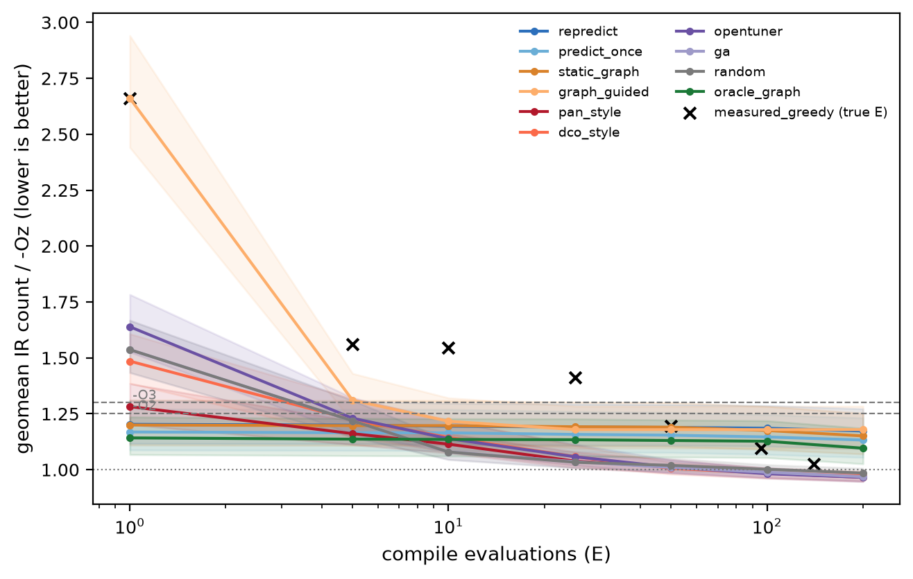

# OptGraph

**Program-Conditioned Quantification and Prediction of LLVM Optimization Pass Interactions**

OptGraph measures how pairs of LLVM optimization passes interact on a given
program, represents those interactions as a directed weighted graph per
program, and tests whether the interaction can be predicted for programs the
model has never seen, from the structure of the unoptimized IR alone.

**Research question.** To what extent do interactions between compiler
optimization passes depend on the structural characteristics of the input
program, and can these program-conditioned interactions be learned and
accurately predicted for previously unseen programs?

Pass interaction, phase ordering, optimization graphs and ML-guided
compilation are all established topics. What this project examines is whether
the *magnitude and direction* of pairwise interactions vary systematically
with program structure, and whether that variation is predictable.

## Results (v3.1, pre-registered)

129 programs from the LLVM test-suite, PolyBench, cBench and the project's own
set; LLVM 21.1.8; objective = IR instruction count relative to `-Oz`. The four
hypotheses and their tests were written down and hashed before the experiments
ran ([`PREREGISTRATION.md`](outputs/v3_1/PREREGISTRATION.md)); p-values are
Holm-corrected across the four.

| # | Claim | Result | Holm p | Supported |
|---|---|---|---|---|
| H1 | Ordering passes from a program's own interaction graph beats a graph averaged over the other programs (10 compile evaluations) | geomean IR count ratio 0.949; better on 95 of 129 programs | 2.6e-9 | yes |
| H2 | Interactions change as the pipeline runs (start of pipeline vs after 15 stages) | median Spearman ρ 0.29 | 8.0e-21 | yes |
| H3 | A model trained on other programs predicts a new program's interactions better than the averaged graph | residual R² 0.50; lower error on 127 of 129 programs | 4.1e-21 | yes |
| H4 | Re-predicting interactions during search beats the strongest other search method at 10 evaluations | ratio 1.107 vs a genetic algorithm (worse) | 1.0 | **no** |

So interactions are program-specific, they drift through the pipeline, and they
can be predicted, but at this budget the prediction-driven search did not beat
a genetic algorithm. Full numbers: [`RESULTS.md`](outputs/v3_1/RESULTS.md),
[`results_v3_1.json`](outputs/v3_1/results_v3_1.json); exploratory analyses:
[`ANALYSIS.md`](outputs/v3_1/ANALYSIS.md).



*IR count relative to `-Oz` (lower is better) against the number of compile
evaluations, for every search method; dashed lines are `-O2` and `-O3`.*

## Pipeline

```
C program ──clang -O0──> LLVM IR (P) ──┬──> structural features (original IR only)
                                       │
                                       └──> opt:  P→A   P→B   P→A→B   P→B→A
                                                    │
                                              IR measurements
                                                    │
                              I(A,B,P) = Δ(B | A,P) − Δ(B | P)
                                                    │
                    ┌───────────────────────────────┼───────────────────────────┐
              per-program graph             interaction dataset          similarity analysis
                                                    │
                                 ML: features + pass pair → I   (split by program)
```

## Quick start

Requires Linux or WSL with Clang/LLVM (see [Setup](#setup-wsl--ubuntu)).

```bash
python run_demo.py                                   # ~10 s end-to-end demo, one program, one pair
python run_demo.py --program mix_01_matrix_mul --pass-a licm --pass-b instcombine
python run_demo.py --list                            # built-in programs and passes
python run_demo.py --file examples/custom_example.c  # any C/C++ program of your own
python run_demo.py --file my.c --pass-a mem2reg --pass-b gvn
```

A file passed with `--file` must be a complete program (with `main`) that
compiles with clang, needs no keyboard input and finishes within 10 seconds.
It is not added to the dataset; the demo's ML step then reports a prediction
for a program the model has never seen.

## Reproducing the results

**Rebuild every v3.1 table, figure and paper number from the recorded data (no experiments are re-run):**

```bash
export OPTGRAPH_CONFIG=v3_1.yaml && python scripts/v3_1_report.py && python scripts/v3_1_analysis.py && python paper/make_numbers.py
```

This reads `data/v3_1/` only. It writes `outputs/v3_1/{report,tables,figures,RESULTS.md,results_v3_1.json,ANALYSIS.md}` and `paper/numbers.tex`.

**Re-run the v3.1 experiments:** `OPTGRAPH_CONFIG=v3_1.yaml bash scripts/run_v3_1.sh`, then `bash scripts/run_v3_1.sh --runtime` (alone, serial), then `python scripts/v3_1_report.py`.

**Earlier pipeline (24 programs, 12 passes):**

```bash
python scripts/run_experiments.py --quick            # 6 programs x 5 passes  -> data/quick/
python scripts/run_experiments.py --full --verify-outputs   # 24 programs x 12 passes (~95 s)
python scripts/build_graph.py                        # outputs/graphs/
python scripts/train_model.py                        # outputs/plots/, outputs/models/, outputs/reports/
python scripts/analyze_similarity.py                 # hypothesis check
python scripts/summarize_results.py                  # descriptive statistics
bash scripts/run_all.sh                              # all of the above, in order
```

`run_experiments.py` also accepts `--programs`, `--program`, `--passes`,
`--pass-a/--pass-b`, `--tag` and `--workers`. `--verify-outputs` links and runs
every optimized IR and fails the experiment if the program's output changes.
Method, results and limitations of this earlier version:
[`outputs/research_summary.md`](outputs/research_summary.md).

**Tests:** `python -m pytest` (tests that need clang or OpenTuner are skipped when those are missing).

## Definitions

**Metrics** (counts over function bodies of the textual IR): instruction count,
basic blocks, branches, conditional branches, loads, stores, PHIs, calls. They
are analysed separately; they are never merged into one score. In the earlier
pipeline runtime is not used: those benchmarks finish in microseconds and
timing would be noise.

**Improvement.** `(baseline − optimized) / baseline`; positive = the count went down.

**Interaction.** For metric *m*:

```
Δ(B | P)    = ( m(P)    − m(B(P))    ) / m(P)
Δ(B | A, P) = ( m(A(P)) − m(B(A(P))) ) / m(P)
I(A, B, P)  = Δ(B | A, P) − Δ(B | P)
```

Both terms are fractions of the *original* program's metric, so `I` is the
pair's departure from additivity. `I > +0.005` synergy, `I < −0.005`
antagonism, otherwise weak (threshold in `config/passes.yaml`).
`I(A,B,P) − I(B,A,P) = (m(A(B(P))) − m(B(A(P)))) / m(P)`: the asymmetry of the
graph is exactly the phase-ordering effect of the pair.

**Zero baseline.** If `m(P) = 0` (the PHI count of `-O0` IR is always 0) the
normalised score is undefined. The row keeps the absolute interaction
(`interaction_abs`), is labelled `UNDEFINED`, and is excluded from modelling.

**Leakage control.** Model inputs are the `f_*` columns (features of the
original IR) and the pass identities. Train/validation/test are split **by
program**; leave-one-program-out cross-validation is reported as well.

## Limitations

- **IR count is the objective.** All four hypotheses use IR instruction count. The H1 headroom is
  confirmed in `.text` size on x86-64 and AArch64; evidence for executed instructions and wall-clock
  time is only suggestive, and sequences that minimise IR count are slower than `-O3`.
- **One compiler version, one machine.** LLVM 21.1.8 on one x86-64 laptop; AArch64 numbers are
  compile-only code size. Other LLVM versions change the pass pipeline.
- **Timing noise.** Timing ran under WSL2 on a laptop (serial, pinned to one core, 20 randomised runs
  per binary). No hypothesis depends on timing.
- **Reimplemented baselines.** The DCO-style and Pan-style searches reimplement the published ideas
  under a common budget; they are not the original systems.
- **Corpus.** 129 programs, many of them small kernels; results may differ on large applications.

## Setup (WSL / Ubuntu)

```bash
sudo apt update && sudo apt install -y clang llvm libc6-dev python3-venv python3-pip
python3 -m venv .venv
source .venv/bin/activate
pip install -r requirements.txt
python scripts/check_environment.py
```

Keep the repository on the Linux filesystem (e.g. `~/OptGraph`) rather than
under `/mnt/c/`; experiments are much slower across the Windows boundary.

Developed with Ubuntu 26.04 (WSL2), Clang/LLVM 21.1.8, Python 3.14.
`environment.json` records the exact versions of the last run.

## Layout

```
config/passes.yaml          passes (exact opt pipeline strings), thresholds, quick subset
benchmarks/<category>/      24 deterministic C programs in 5 categories (earlier pipeline)
src/llvm_pipeline.py        the only place that builds clang/opt command lines
src/metrics.py              IR text parser and metric definitions
src/features.py             structural features of the original IR
src/experiments.py          P, P→A, P→A→B runner with per-experiment logging
src/interaction.py          interaction score and dataset construction
src/graph.py                per-program and aggregate graphs
src/model.py                models, program-level splits, leave-one-program-out
src/evaluation.py           metrics, plots, similarity analysis
src/suites.py, search.py    v3/v3.1 benchmark suites and search methods
scripts/                    command-line entry points (v3_* and v3_1_* for the later versions)
run_demo.py                 end-to-end demonstration
data/                       program_features.csv, interaction_dataset.csv, results/, v3_1/
outputs/                    graphs, plots, models, reports; outputs/v3_1/ for the pre-registered study
paper/                      paper draft (LaTeX; paper/overleaf.zip uploads directly to Overleaf)
tests/                      pytest suite
```
